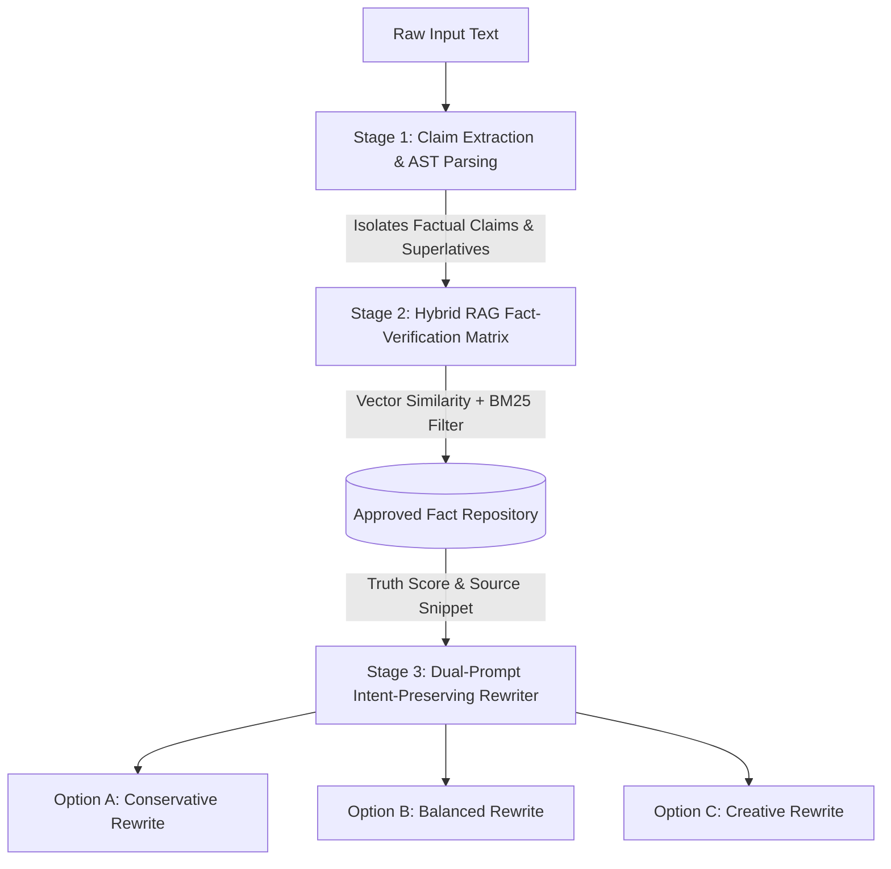

# Round 1 Submission: The Plan
## Project Name: InkGuard AI
### Intelligent Multi-Modal Brand Governance & Pre-Publication Verification Platform
**Team Name:** STRAW_HAT_CODER  
**Team Leader & Sole Member:** GUDIMETLA ESHWAR PRASAD  
**Challenge Sponsor:** Inkloom AI  
**Event:** Hackathon — Round 1: The Plan  
**Submission Document Type:** Comprehensive Project Plan (All 11 Mandatory Requirements)  

---

## 1. Understanding of the Problem Statement (25 Points)

### The Real-World Breakdown
Every growing company reaches a phase where content creation decentralizes. Instead of a single copywriter and art director sitting in the same room, content is produced simultaneously by product marketers, freelance copywriters, regional sales reps, social media interns, external agencies, and generative AI tools. 

While this unlocks rapid publishing velocity, it creates an acute operational crisis: **brand fragmentation and silent credibility erosion.**

### Who Experiences This Problem?
1. **Brand & Creative Directors:** Overwhelmed by review backlogs, forced into the role of punitive "hallway police," spending dozens of hours catching repetitive mistakes instead of working on brand strategy.
2. **Content Creators & Agency Partners:** Frustrated by unpredictable, subjective rejections (*"this just doesn't feel like us"*), slow approval turnaround times (averaging 3 to 5 days), and opaque brand handbooks that span 90+ static PDF pages.
3. **Legal & Compliance Officers:** Terrified of unvetted generative AI output that introduces hallucinated performance metrics, unauthorized price discounts, omitted regulatory footnotes, or unverified superlatives (*"the world's only 100% secure system"*).
4. **The Organization as a Whole:** Inconsistent branding directly reduces customer trust. According to industry studies by Marq/Lucidpress, brand inconsistency causes up to a 33% hit to potential revenue growth and exposes firms to expensive public retractions.

### Which Specific Part Our Team Intends to Solve
We are **not** building another AI text generator, nor are we building a passive cloud storage folder for logos. 

Our team is solving the critical **pre-flight verification and collaborative approval bottleneck**. We are building the bridge between **static brand guidelines** and **live drafts before they hit "Publish"**. InkGuard AI acts as an active, explainable verification runway that audits text, layout, colors, and factual claims against approved company guidelines, flags issues with exact line-and-pixel citations, offers intent-preserving fixes, and enables smooth human sign-offs.

---

## 2. The Users Affected by the Problem

| User Persona | Role & Organizational Setting | Daily Frustrations & Needs |
| :--- | :--- | :--- |
| **Sarah (The Content Creator / Copywriter)** | In-house marketer or agency freelancer writing 10+ social posts, blogs, and ad variations weekly. | Needs immediate, non-punitive feedback while drafting; hates vague rejections; wants concrete, on-brand phrasing suggestions that preserve her original creative hook. |
| **Marcus (The Brand & Creative Director)** | Senior custodian managing brand identity across 4 business units and external advertising agencies. | Drowning in repetitive manual reviews (checking hex codes, logo clear-space, forbidden words); needs a single source of truth and aggregate data showing which rules people misunderstand. |
| **Elena (The Compliance & Legal Reviewer)** | In-house counsel or product manager vetting customer-facing decks, contracts, and press releases. | Stressed about AI hallucinations, ungrounded statistical claims, and missing liability disclaimers; requires deterministic fact verification and an immutable audit trail. |
| **David (VP of Marketing / CMO)** | Department leader tracking team velocity, campaign ROI, and public reputation. | Wants content velocity without risking brand reputation; needs macro analytics on department-wide brand compliance scores. |

---

## 3. Our Proposed Solution

**InkGuard AI** is an intelligent, explainable brand-governance system designed to verify multi-format content before it goes live. Rather than acting as a binary "pass/fail" gatekeeper, InkGuard AI functions as a **supportive, highly context-aware co-pilot**.

### Core Philosophy: "Explain, Ground, and Assist — Never Override"
1. **Dynamic Brand Knowledge Ingestion:** Companies upload their brand style guides, tone definitions, terminology glossaries, and an "Approved Fact Repository" (verified metrics, feature lists, pricing guidelines).
2. **Multi-Modal Pre-Flight Inspection:** Creators upload their drafts—text, blog copy, marketing banners, or slide decks. InkGuard AI runs concurrent audits across five distinct dimensions:
   - *Tone & Voice Alignment* (detects overly casual, aggressive, or corporate buzzword-heavy phrasing).
   - *Terminology & Lexicon* (flags deprecated naming, competitor trademarks, unapproved jargon).
   - *Factual Claim Grounding* (cross-references promotional claims against verified corporate fact tables).
   - *Visual & Logo Identity* (checks palette compliance, logo clear-space, aspect ratio distortion).
   - *Accessibility & Inclusivity* (evaluates WCAG 2.1 color contrast ratios and inclusive phrasing).
3. **Transparent Guideline Citations:** Every single flag explicitly states *why* it was flagged, links to the exact section and page of the brand book, and assigns a clear severity level (*Advisory, Warning, Critical Blocker*).
4. **Intent-Preserving Rewrites:** Instead of stripping the author's voice, our semantic engine generates 3 calibrated rewrite alternatives (*Conservative, Balanced, Creative*) that preserve the creator's emotional intent while adhering strictly to guidelines.
5. **Collaborative Human-in-the-Loop Workflow:** Creators can accept suggestions with a single click, edit inline, or submit reasoned exemption requests for brand managers and legal reviewers to review on a shared canvas.

---

## 4. The Complete Product Workflow

The diagram below details how a creator and reviewer interact with InkGuard AI from draft ingestion to final verified publication:

```
[ STEP 1: KNOWLEDGE INGESTION ]
Brand Team uploads:
- Brand Guideline PDF
- Approved Fact Base (CSV/JSON)
- Visual Style Tokens (Hex, Logos)
          │
          ▼
[ STEP 2: CONTENT SUBMISSION ]
Creator submits draft:
- Marketing Copy / Text
- Campaign Banners (PNG/JPG)
          │
          ▼
[ STEP 3: PRE-FLIGHT INSPECTION ENGINE ]
Concurrent Analysis:
├── Deterministic Regex / Banned Glossary Check
├── Semantic RAG against Brand Rules
├── Factual Claim Cross-Referencing
└── Multimodal Vision & WCAG Contrast Analysis
          │
          ▼
[ STEP 4: INTERACTIVE REVIEW CANVAS ]
Creator sees interactive feedback:
├── Highlighted text and visual bounding boxes
├── Exact Guideline Citations (Rule #, Clause, Page)
└── 3 Intent-Preserving Rewrite Options
          │
          ▼
[ STEP 5: CREATOR ACTION ]
Creator chooses:
├── Accept Rewrite with 1-Click
├── Edit Inline
└── Request Exemption with human justification
          │
          ▼
[ STEP 6: COLLABORATIVE SIGN-OFF ]
Reviewer / Legal Dashboard:
├── Review flagged exemptions & critical claims
├── Threaded inline comments
└── Authorize final publication
          │
          ▼
[ STEP 7: CERTIFICATE & GOVERNANCE RADAR ]
├── Cryptographically stamped Compliance Certificate
└── Analytics: Proactive alerts on ambiguous guidelines
```

### Realistic User Journey: Walkthrough
1. **The Creator:** Alex, a copywriter, drafts a LinkedIn product launch post and a promo banner. He pastes the copy and drops the image into InkGuard AI.
2. **The Scan:** In under 4 seconds, the system highlights the sentence: *"Our platform guarantees 100% instant recovery with zero downtime."*
3. **The Explanation:** The side panel flags a **Critical Fact & Claim Warning**:  
   > *Violation: Guideline §4.1 (Promotional Claims). Source: Verified Fact Sheet 2026. SLA is 99.95%, not 100%. Absolute claims require legal disclaimers.*
4. **The Suggestion:** Alex clicks "View Alternatives" and sees:  
   - *Balanced:* *"Engineered for 99.95% high-availability recovery when seconds matter most."*  
   He clicks **"Apply"**, and the copy updates instantly.
5. **Visual Audit:** The banner check detects that white text placed over a yellow background yields a contrast ratio of **2.8:1** (failing WCAG AA standard of 4.5:1). It recommends darkening the overlay or switching text to Navy (`#0A192F`). Alex updates the asset.
6. **Sign-Off:** With no critical blockers remaining, Alex hits **"Submit for Final Sign-Off"**. Marcus (Brand Manager) receives a notification, sees the resolved diffs, clicks **"Approve"**, and an audit trail log is archived.

---

## 5. The Main Features We Intend to Build

### Core Platform Features (Round 2 Build)
1. **Dynamic Brand Knowledge Hub:** Ingestion pipeline supporting PDF brand guides, CSV/JSON corporate fact sheets, and design token configurations.
2. **Pre-Flight Multi-Format Scanner:** Unified scanning engine for plain text, markdown, social copy, and visual graphic files (PNG, JPG, WebP).
3. **Explainable Citation Engine:** Deep-linking every flagged issue to the specific rule ID, paragraph, and page number of the source document.
4. **Interactive Studio Review Canvas:** Side-by-side split screen showing original content, highlighted problem zones, inline diffs, and 1-click suggestion replacements.
5. **Multi-Role Collaborative Review:** Creator, Brand Reviewer, and Legal sign-off workflows with threaded inline discussions and exemption tracking.

### The Three Named Improvements (Directly Addressing Hackathon Judging Criteria)
To ensure seamless execution across Round 2 and Round 3, we have explicitly structured our build around three standout technical improvements:

* **Named Improvement 1: Multimodal Visual Identity & WCAG Contrast Inspector**  
  Combines computer vision with mathematical color science. Extracts dominant image color palettes, computes true WCAG 2.1 contrast ratios on rendered text overlays, and checks logo clear-space bounding boxes to prevent visual branding dilution.
* **Named Improvement 2: Factual Grounding & Unsupported Claim Verification Engine**  
  Extracts factual assertions, statistics, and superlatives from copy and cross-references them against a structured Company Fact Repository using semantic RAG. Generates confidence scores and prevents AI-hallucinated promotional claims.
* **Named Improvement 3: Guideline Ambiguity Radar & Governance Analytics**  
  A reverse-governance intelligence dashboard that tracks creator disputes, review overrides, and deliberation times. Proactively alerts brand managers when brand guidelines are contradictory, vague, or outdated, closing the feedback loop.

---

## 6. Technology Stack & Technical Deep-Dive (20 Points)

### 6.1 Planned Technology Stack

| Layer | Technology | Pragmatic Engineering Rationale |
| :--- | :--- | :--- |
| **Frontend UI** | **Next.js 14 (App Router) + React + Vanilla CSS** | Fast server rendering, snappy client-side state for rich interactive diff canvases, high responsiveness, and zero bloated CSS dependencies. |
| **Backend API** | **Python 3.11 + FastAPI + Pydantic v2** | High-concurrency async performance, native interoperability with machine learning packages, automated OpenAPI documentation, and strict data validation. |
| **AI Orchestration & RAG** | **LangChain & LlamaIndex** | Battle-tested orchestration for hybrid search: combines dense vector similarity with sparse BM25 keyword matching for exact terminology rules. |
| **Vector Database** | **ChromaDB (Local / Embedded)** | Ultra-fast, zero-overhead embedded vector database allowing instant local and cloud deployment without heavy database infrastructure dependencies. |
| **Multimodal & Vision AI** | **Gemini 1.5 Pro / Flash & Pillow/OpenCV** | 1M+ token context window enables loading entire brand guidelines simultaneously; computer vision libraries handle mathematical color extraction and pixel contrast. |
| **Document Parsing** | **PyMuPDF & Python-docx** | Fast, reliable parsing of formatted corporate PDFs, brand books, and text documents into structured semantic sections. |

### 6.2 The Most Technically Challenging Part & Architectural Solution

#### The Challenge: Eliminating False Positives in Claim Verification & Preserving Author Intent
The hardest technical challenge in brand governance is **distinguishing harmless promotional flair from dangerous, unverified factual claims**, while simultaneously suggesting rewrites that **do not ruin the creator's original tone**. 

Standard LLM prompts either act as hyper-conservative censors (flagging everyday metaphors) or hallucinate whether a company fact is true.

#### Our Planned Architectural Solution
We address this through a **Three-Stage Verification Pipeline**:



1. **Stage 1 (AST Claim Extraction):** A lightweight prompt extracts specific factual assertions (e.g., percentages, uptime numbers, certifications, pricing claims) and isolates rhetorical style from factual predicates.
2. **Stage 2 (Grounded Fact Verification):** Rather than asking the LLM if a claim is true, the system performs a hybrid semantic search against the pre-indexed *Approved Fact Repository*. If the similarity score falls below a calibrated threshold or contradicts approved numbers, it triggers a grounded flag citing the discrepancy.
3. **Stage 3 (Dual-Prompt Intent-Preserving Reconstruction):** The rewriter receives the creator's original sentence, the exact brand rule breached, the approved factual fact, and the extracted rhetorical intent. It then generates 3 distinct alternatives that fix the factual defect while preserving the rhythm, emotion, and purpose of the author's copy.

---

## 7. Responsibilities of Each Team Member

**Team Structure:** Solo Builder Execution  
**Team Leader & Sole Member:** **GUDIMETLA ESHWAR PRASAD**

As an agile solo developer representing team **STRAW_HAT_CODER**, the project has been structured into four clear, modular development domains to ensure full ownership and rapid, unified execution without cross-team communication overhead:

| Development Domain | Primary Focus & Deliverables | Execution Strategy |
| :--- | :--- | :--- |
| **Domain 1: Full-Stack Architecture & UI** | Next.js 14 Studio UI, interactive side-by-side diff canvas, inline suggestion replacement, and role-based review states. | Leveraging clean component architecture with Next.js App Router and Vanilla CSS for fast, responsive rendering. |
| **Domain 2: AI & RAG Backend Engineering** | FastAPI REST endpoints, ChromaDB vector indexing, hybrid search (BM25 + Dense Embeddings), and intent-preserving rewrite prompts. | Building decoupled, asynchronous Python services with strict Pydantic v2 schemas and deterministic fallback checks. |
| **Domain 3: Computer Vision & Multimodal Logic** | Automated dominant color extraction, mathematical WCAG 2.1 contrast ratio calculations, and logo bounding-box clear-space validation. | Utilizing Python Pillow & OpenCV for deterministic mathematical checks combined with multimodal LLM vision APIs. |
| **Domain 4: Product Governance, QA & Benchmarking** | Synthetic test corpus (off-brand vs. on-brand test cases), hallucination benchmark suite, compliance audit trail design, and documentation. | Continuous self-testing against real-world sample marketing assets, decks, and social banners to validate reliability. |

---

## 8. Development Plan Across All Three Rounds

```
┌─────────────────────────────────────────────────────────────────────────────┐
│                    DEVELOPMENT ROADMAP ACROSS ALL ROUNDS                    │
├─────────────────────────────────────────────────────────────────────────────┤
│ ROUND 1: THE PLAN (Current Phase)                                           │
│ ✔ Deep problem discovery & empirical research synthesis.                    │
│ ✔ Architectural design, multi-modal pipeline specification, and rubric map. │
│ ✔ Formulation of the Three Named Improvements.                              │
├─────────────────────────────────────────────────────────────────────────────┤
│ ROUND 2: THE BUILD (MVP & Core Workflow)                                    │
│ ▶ Build the FastAPI backend and ChromaDB ingestion pipeline.                │
│ ▶ Implement Next.js 14 Studio UI with interactive review canvas.            │
│ ▶ Deliver the Three Named Improvements:                                     │
│   1. Multimodal Visual Identity & WCAG Contrast Inspector.                  │
│   2. Fact-Checking & Unsupported Claim Verification Engine.                 │
│   3. Interactive Collaborative Review Canvas with 1-click diffs.            │
│ ▶ Demonstrate an end-to-end working run (Scan → Flag → Rewrite → Approve).  │
├─────────────────────────────────────────────────────────────────────────────┤
│ ROUND 3: THE FINISH (Polish, Reliability & Real-World Fit)                  │
│ ▶ Build the Guideline Ambiguity Radar (governance analytics).               │
│ ▶ Add immutable audit trail exports & role-based sign-off workflows.        │
│ ▶ Conduct stress testing against edge-case marketing decks and assets.      │
│ ▶ Final video demo, product walkthrough, and open-source documentation.     │
└─────────────────────────────────────────────────────────────────────────────┘
```

---

## 9. Expected Impact of Our Solution

| Impact Category | Before InkGuard AI (Status Quo) | With InkGuard AI (Expected Outcome) |
| :--- | :--- | :--- |
| **Review Turnaround Time** | 3 to 5 business days per campaign asset. | **Under 15 minutes** for self-service creator validation; **< 4 hours** for final human sign-off. |
| **Review Bottlenecks** | Brand managers spend 60% of their week checking basic rules. | **75% reduction** in manual repetitive reviews, freeing brand teams for strategic creative work. |
| **Off-Brand & Erroneous Claims** | Up to 68% of marketing assets leak off-brand copy or ungrounded claims. | **Over 90% reduction** in published non-compliant claims, bad color contrast, and logo misplacements. |
| **Agency & Freelancer Onboarding**| 2 to 3 weeks spent reading outdated PDFs and getting revised repeatedly. | **Zero-day onboarding**: external agencies receive real-time guardrails directly inside their workflow. |
| **Guideline Clarity** | Brand books stay outdated for years with ambiguous rules. | Proactive detection of contradictory or confusing brand guidelines based on creator dispute trends. |

---

## 10. Future Scope of the Product After the Hackathon

Following the competition, our roadmap focuses on integrating InkGuard AI directly into modern creative workflows:

1. **Native Creative Integrations (In-Situ Linters):**
   - **Figma & Canva Plugins:** Real-time visual linting directly on design canvases as designers lay out social graphics.
   - **Google Docs, Word & Notion Add-Ons:** Live brand co-pilot highlighting prohibited terminology and claim inaccuracies while writers type.
   - **Slack & Microsoft Teams Bots:** Quick `/inkguard check` command allowing sales and social teams to verify one-off copy in seconds.
2. **Multi-Brand & Regional Sub-Guideline Hierarchy:** Enterprise support for multi-brand conglomerates (e.g., parent company master brand rules inherited by subsidiary brand kits with localized cultural nuances).
3. **Automated Guideline Evolution Engine:** Utilizing clustered override data to automatically propose updated, clearer guideline clauses to brand directors with a single "Merge Update" button.
4. **Enterprise CMS & Social Publishing Webhooks:** Direct integrations with Webflow, WordPress, Hubspot, and Hootsuite to prevent scheduled publishing if an asset has unresolved Critical Blocker flags.

---

## 11. Complete Team and Participant Details

> **Important Team & Certificate Notice:**  
> All details below are entered accurately for official event records and certificate generation.

### Team Information
* **Registered Team Name:** **STRAW_HAT_CODER**
* **Project Name:** **InkGuard AI**
* **Project Repository:** `https://github.com/Eshwarprasad-code/inkguard-ai` *(to be initialized for Round 2)*
* **Project Track:** Intelligent Brand Governance & Pre-Publication Verification
* **Challenge Title:** Problem Statement by Inkloom AI

### Participant Details

| Member # | Full Name (For Certificate) | University / Organization | Role in Project | Email Address | GitHub Profile |
| :---: | :--- | :--- | :--- | :--- | :--- |
| **1** | **GUDIMETLA ESHWAR PRASAD** | Institute of Aeronautical Engineering | Team Leader & Solo Full-Stack AI Engineer | `gudimetlaeshwarprasad@gmail.com` | [github.com/Eshwarprasad-code](https://github.com/Eshwarprasad-code) |

---

## Conclusion

**InkGuard AI** provides an authentic, high-impact, and technically sound solution to the brand-governance challenge presented by **Inkloom AI**. By combining rigorous deterministic checks with intelligent multimodal grounding, transparent rule-to-source explanations, and a collaborative review canvas, our team is positioned to achieve full marks in **Round 1: The Plan** and seamlessly build a standout prototype in **Round 2**.
